## 핵심 역량
- MySQL 실행계획과 API 부하 지표를 분석해 병원 검색의 JOIN 순서와 인덱스 접근 경로를 개선했습니다.
- 공공 API 수집·검증·DB 반영을 분리하고, 장애 주입으로 기존 데이터 보존 여부를 확인했습니다.

## 프로젝트 경험
**CureLingo — 외국인을 위한 다국어 의료기관 검색·AI 안내 서비스** 백엔드 2인 팀 / 담당: 병원·응급실 검색 API, 공공 데이터 연동, SQL 개선 및 성능·장애 검증 Java 17 · Spring Boot · MySQL 8.4 · Docker · GCP · k6 · Prometheus · Grafana [최종 구현](https://github.com/jongmine/curelingo-backend/tree/release-v2) · [SQL·측정·재현 근거](https://github.com/jongmine/curelingo-backend/blob/release-v2/docs/verification.md)

---

## 1. 진료과 조건 선적용과 상세 JOIN 범위 축소로 병원 검색 p95 64.1% 감소

### 문제 원인
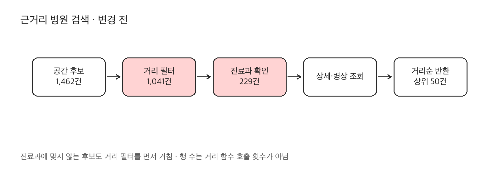
1. 사용자가 위치·진료과로 병원을 찾는 검색 경로에서 DB CPU와 SQL 실행시간 증가를 관측했습니다.
2. 커넥션 획득 대기와 DB CPU를 함께 살펴보고, 앱 CPU·JVM·Tomcat 지표를 대조해 SQL 실행계획을 우선 조사했습니다.
3. 공간 인덱스로 찾은 후보 1,462건에 반경 필터를 적용한 뒤 남은 1,041건의 진료과를 검사하는 실행 경로를 확인했습니다.

### 해결 과정
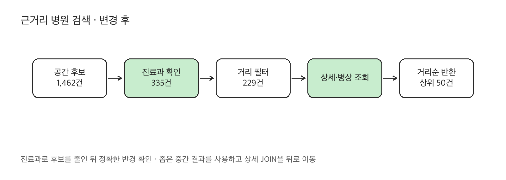
1. `hospital_department(hpid, department_code)` 기본키로 진료과 조건을 먼저 검사해 후보를 335건으로 줄인 뒤 `ST_Distance_Sphere`로 반경을 판정했습니다.
2. 첫 수정안은 상세·병상 JOIN을 CTE 안에 포함해 검사 행이 줄어도 지연이 악화됐습니다. 최종안은 중간 열을 식별자·위치·거리로 줄이고 상세 JOIN을 필터 뒤로 옮겼습니다.
3. `NO_MERGE` 등 힌트와 실제 실행계획으로 처리 경로를 확인하고, 동일 snapshot의 거리순 상위 50개 병원 식별자·순서를 대조했습니다.

[현재 검색 구현](https://github.com/jongmine/curelingo-backend/blob/release-v2/src/main/java/com/curelingo/curelingo/publicdata/mysql/db/HospitalSearchRepository.java) · [측정 SQL·실행계획](https://github.com/jongmine/curelingo-backend/blob/release-v2/docs/evidence/nearby/after-nearby.sql) *CTE 자체가 성능을 보장하는 것은 아닙니다. 첫 수정안의 중간 결과 폭과 JOIN 위치가 각각 미친 영향은 분리하지 않았습니다.*

### 결과
1. 목표 28 RPS에서 실행별 HTTP p95의 3회 중앙값이 **358.3 → 128.6ms(64.1% 감소)**로 낮아졌습니다.
2. Performance Schema로 계측한 **SQL당 검사 행이 1,975 → 619행(68.7% 감소)**으로 줄었고, DB VM CPU 사용률 중앙값도 83.9 → 49.3%로 낮아졌습니다.
3. 전후 각 3회에서 요청 실패 0건, HTTP 200·응답 형식·식별자 중복·반경·거리 정렬 검사가 모두 통과했습니다.

**변경 전 — HTTP 지연 / DB VM CPU**

	
		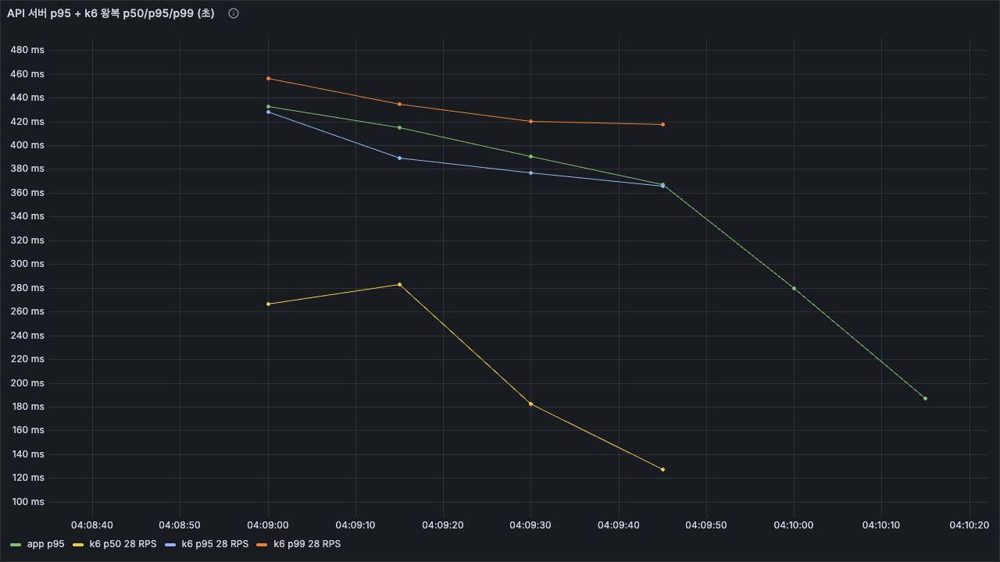
	
	
		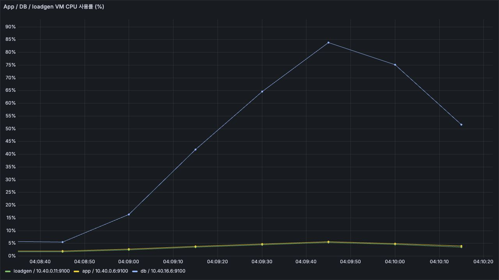
	

**변경 후 — HTTP 지연 / DB VM CPU**

	
		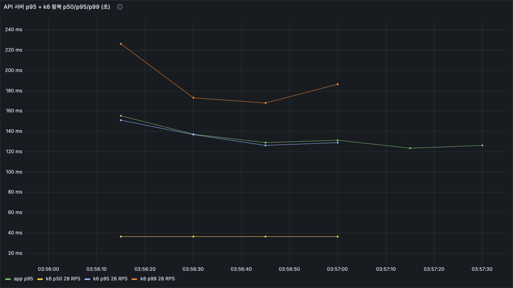
	
	
		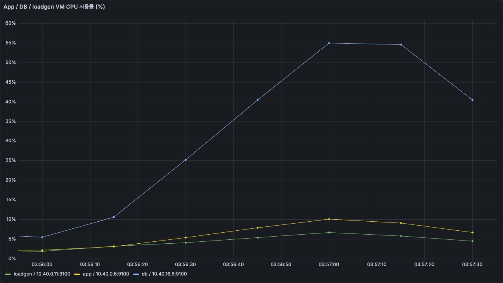
	

*지연 패널에서는 k6 p95, CPU 패널에서는 DB VM 선을 확인합니다. 표기 수치는 실행 전체 k6 summary의 p95이며 Grafana의 시간 구간별 p95와 구분합니다. 그림은 대표 실행, 성과는 3회 중앙값입니다. CPU 패널의 Y축 범위가 다릅니다.*

측정 조건·3회 결과·진단 근거

	서울시청 중심·3km·D001·50건, 각 60초, 앱·DB·부하 발생기 각각 2 vCPU/4GB, MySQL8.4.11, HikariCP 최대 풀 크기10. 병원79,019건·진료과 관계163,542건·병상416건 snapshot.
	기준 p95: 372.9 / 198.5 / 358.3ms. 변경 p95: 131.7 / 128.6 / 120.1ms.
	기준은 9월28일 24/28 RPS 단계 교차, 변경은 9월30일 매회 2 RPS 60초 워밍업과20초 대기. 날짜·순서가 달라 완전한 교차 A/B는 아닙니다. 28 RPS는 실제 사용자 피크가 아닌 진단 조건입니다.
	이번 원본 프로젝트 통합 후 성능을 재측정한 값은 아닙니다. 당시 측정 SQL·원시 summary와 현재 구현을 각각 연결했습니다.
	별도 9월29일 진단 실행의 p95 716.2ms·DB CPU 중앙값89.2%·HikariCP 대기 스레드 최대11개는 위 비교 기준값과 다릅니다.
	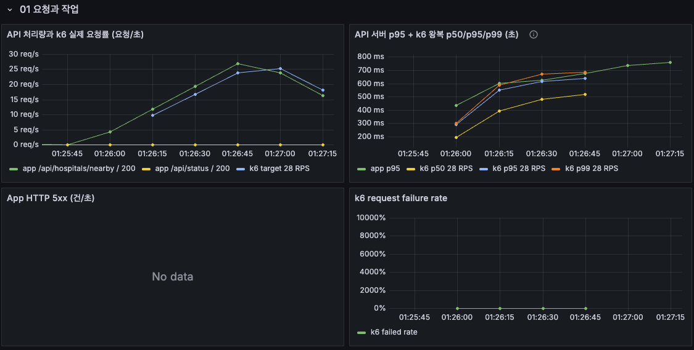
	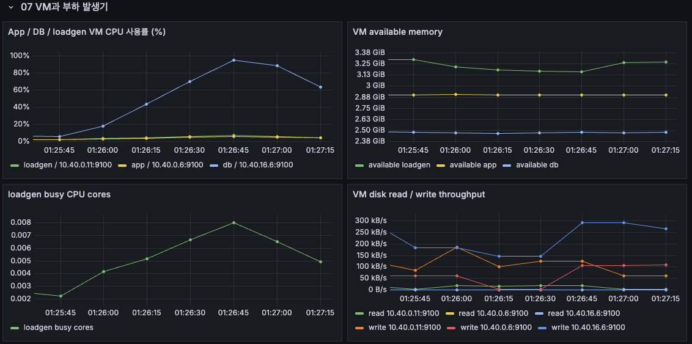
	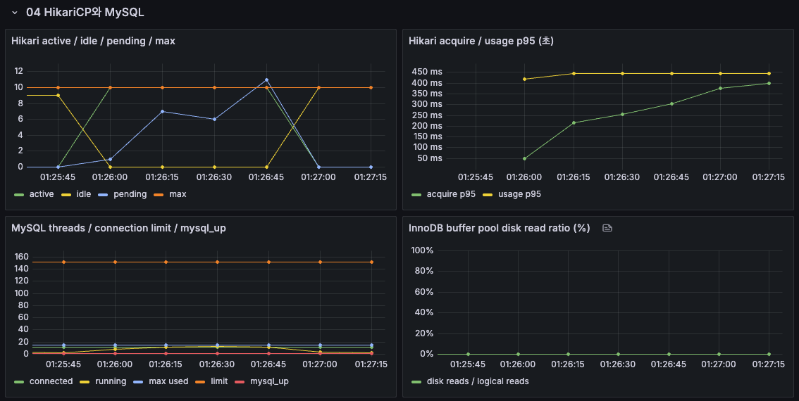
	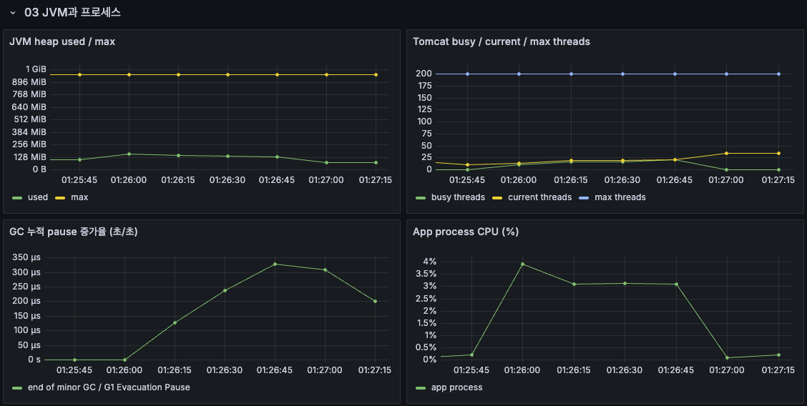
	이 네 장은 2026-09-29 16:25:36–16:27:19 UTC의 실제 과거 시계열입니다. 실패율 패널의 비율 축 설정과 5xx No data를 오류 0건의 근거로 사용하지 않았습니다.
	[반복별 원시 결과와 측정 단위](https://github.com/jongmine/curelingo-backend/blob/release-v2/docs/verification.md)

---

## 2. 병상 수집 결과를 검증하고 트랜잭션으로 반영해 일부 페이지 실패 시 기존 데이터 보존

### 문제 원인
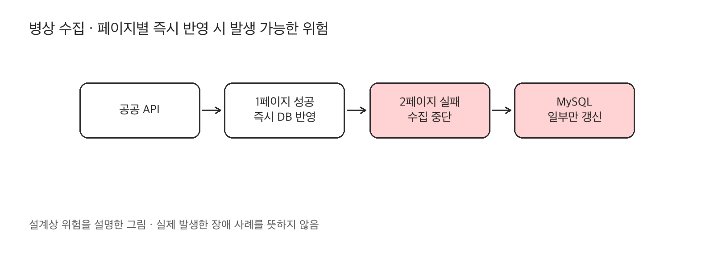
1. 페이지마다 바로 저장하면 뒤쪽 페이지 실패 시 일부 기관만 갱신될 수 있어, 서로 다른 시점의 병상 정보가 노출될 위험이 있었습니다.
2. 응답 타임아웃·건수 불일치·중복 식별자·과거 갱신 시각을 반영하지 않도록 검증 경계를 정해야 했습니다.
3. 응급실 목록에서 병상 0개·정보 없음·오래된 수집을 구분해야 사용자가 정보 상태를 판단할 수 있습니다.

### 해결 과정
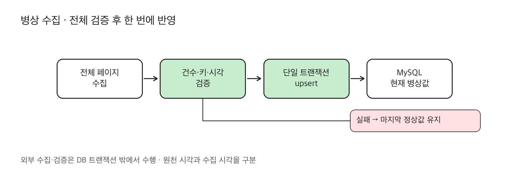
1. 외부 호출과 전체 페이지의 건수·중복 키·숫자·시각 파싱은 **DB 트랜잭션 밖**에서 수행하고, 병상 현재값과 성공 기록만 **하나의 트랜잭션**으로 반영했습니다.
2. 반영 시 과거 갱신 시각을 거부하고 외래 키 오류는 롤백합니다. 타임아웃·최대3회 재시도·재시도를 포함한 일일 호출 예약을 구현했습니다.
3. 병상은 MySQL에 hpid별 현재값을 UPSERT하고 실행 이력은 별도 저장합니다. 응급 목록에서 병상을 LEFT JOIN해 정보 없는 기관도 포함하고, 원천 갱신 시각·수집 시각을 반환합니다.

[수집·반영 코드](https://github.com/jongmine/curelingo-backend/blob/release-v2/src/main/java/com/curelingo/curelingo/publicdata/mysql/sync/BedSyncService.java) · [호출 예산](https://github.com/jongmine/curelingo-backend/blob/release-v2/src/main/java/com/curelingo/curelingo/publicdata/mysql/egen/EgenRequestBudget.java) · [응급 조회](https://github.com/jongmine/curelingo-backend/blob/release-v2/src/main/java/com/curelingo/curelingo/publicdata/mysql/db/EmergencyHospitalRepository.java)

### 결과
1. 실제 공공 API 한 번의 요청에서 415건 수신·totalCount·고유 식별자 수가 일치했습니다. 다중 페이지 실패는 모의 API로 검증했습니다.
2. **원본 프로젝트 통합 코드로 17개 시나리오를 재현했고, 실패 13개에서 기존 값·원천 갱신 시각·수집 시각을 보존했습니다.** 두 번째 페이지 실패·중복 키·과거 시각·외래 키 오류를 포함합니다.
3. 실제 응급 조회 API에서 병상0개/최근 수집·오래된 수집·정보 없는 기관을 확인했습니다. GCP 장애 실험에서도 실패 상태의 API 응답14개에 기존 값과 수집 시각이 유지됐습니다.

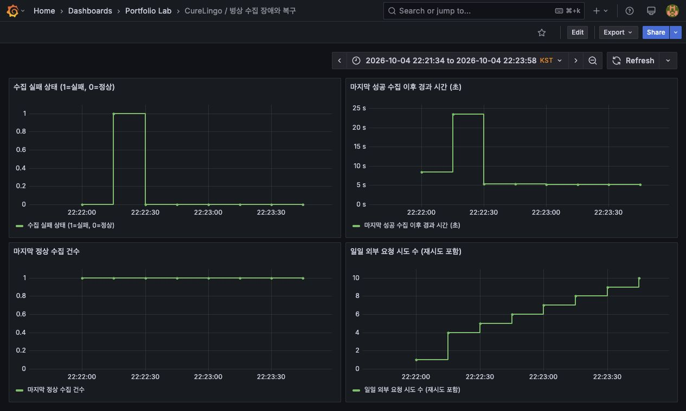
*실패 상태의 전환과 마지막 성공 시각의 흐름을 확인합니다. 값·시각 보존은 별도 API 응답 대조로 확인했습니다. 2026-10-04 GCP 실험은 모의 API의 HTTP503 세 번과 복구를 관측했으며, 수집 간격15초·공공 API 호출0회였습니다.*

검증 범위·수집 주기·저장 판단

	[17개 검증 결과](https://github.com/jongmine/curelingo-backend/blob/release-v2/docs/evidence/bed-20261011/bed-sync-results.json) · [재현 스크립트](https://github.com/jongmine/curelingo-backend/blob/release-v2/scripts/verification/verify-bed-sync.py) · [실제 API 합성 응답](https://github.com/jongmine/curelingo-backend/blob/release-v2/docs/evidence/bed-20261011/api-contract-response.json)
	2026-10-11 실제 MySQL과 원본 JAR로 정상4개/실패13개를 확인했습니다. 모든 장애·다중 수집 서버·강제 프로세스 종료를 검증한 것은 아닙니다.
	최근/오래된 수집은 fetched_at 기준6분으로 구분합니다. 원천 정보의 나이는 sourceUpdatedAt/sourceAgeSeconds로 별도 제공하며 실제 수용 가능성을 보장하지 않습니다.
	3분 fixed delay는 한 페이지 정상 수집 기준 하루 최대480회인 초기 정책입니다. 일일1,000회는 설정한 계정 예산이며 초기 적재·추가 페이지·재시도와 공유합니다. 제공자의 갱신 보장 주기나 공통 한도는 아닙니다.
	스케줄은 기본 비활성화하고 DB당 수집 프로세스 한 개를 전제로 합니다. 같은 인증키를 쓰는 다른 클라이언트의 요청까지 이 예산이 통제하지는 않습니다.
	현재 조회 요구에 맞춰 병상 현재값과 실행 이력을 저장했습니다. 과거 병상 감사·추세 분석 요구가 생기면 변경값 이력을 추가할 수 있습니다.

---

추가 SQL 개선: 응급실 운영 기관을 먼저 조회

	### 문제 원인
	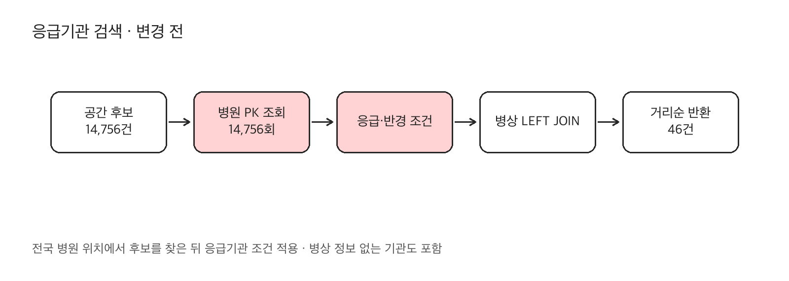
	1. 공간 후보14,756건에 대해 병원 기본키 탐색을 반복한 뒤 응급실 운영 여부를 검사했습니다.
	2. 전국 병원79,019건 중 응급실 운영 기관은519건(약0.66%)이므로 이 조건부터 후보를 줄이는 경로를 비교했습니다.
	3. 병상 정보가 없는 기관도 목록에 남겨야 하므로 병상 테이블부터 조회하는 방식은 채택하지 않았습니다.
	### 해결 과정
	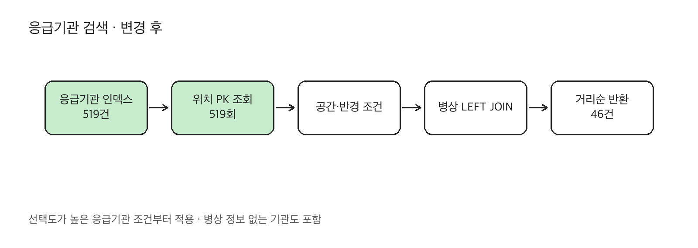
	1. (emergency_room_open, active, hpid) 복합 인덱스를 추가하고 hospital을 시작점으로 조회했습니다.
	2. 기관519건의 위치를 기본키로 찾고 반경을 판정하며 병상 LEFT JOIN을 유지했습니다.
	3. 서울시청10km·limit100에서46건의 모든 컬럼·정렬을 대조하고, 각1회 워밍업 후 두 SQL을3회씩 번갈아 실행했습니다.
	### 결과
	1. 병원 기본키 탐색 loops14,756회 대신 위치 기본키 탐색 loops519회를 수행했습니다. 개별 SQL 요청 수가 아닙니다.
	2. 최종46건의 값과 거리/hpid 정렬 순서를 유지했습니다.
	3. EXPLAIN ANALYZE 계측 실행시간 중앙값256 →9.18ms로 감소했습니다. API p95·동시 부하 성능 개선율과 구분합니다.
	[DDL](https://github.com/jongmine/curelingo-backend/blob/release-v2/src/main/resources/db/20261011-bed-refresh.sql) · [계측 SQL·반복 계획](https://github.com/jongmine/curelingo-backend/blob/release-v2/docs/verification.md)

